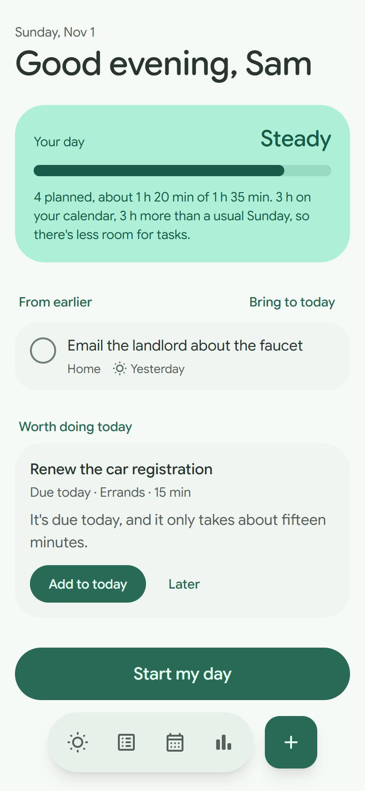
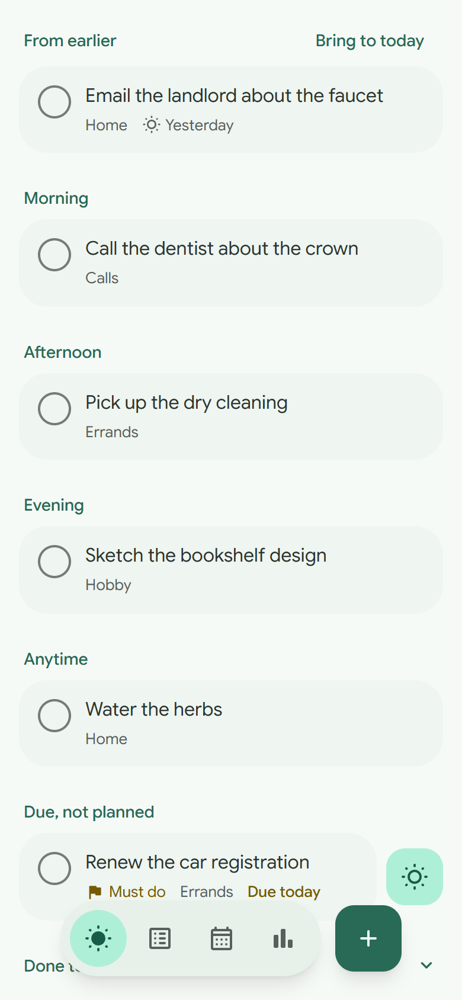
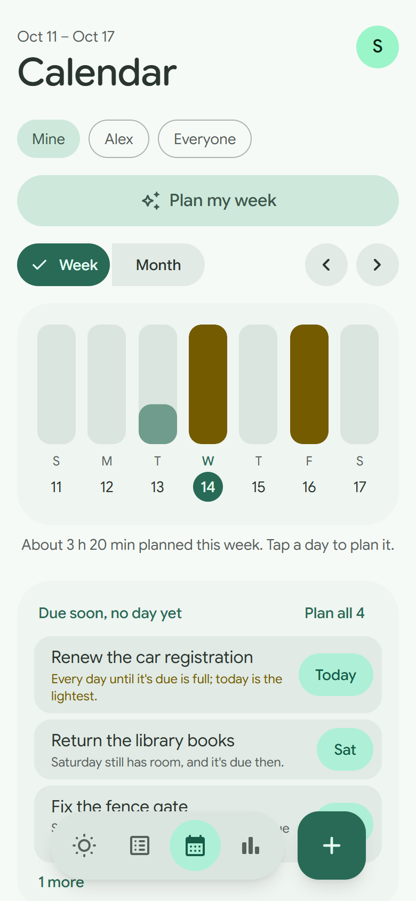
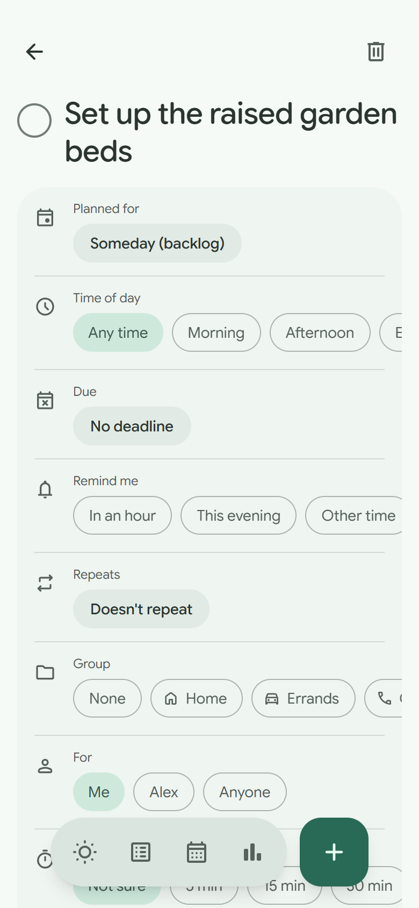
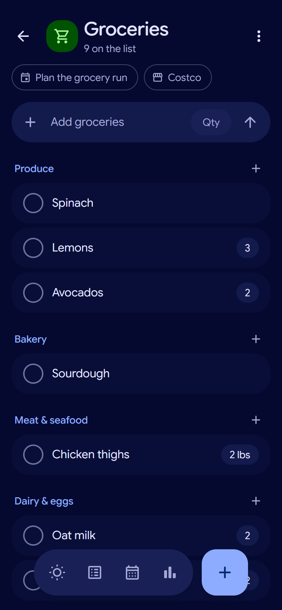
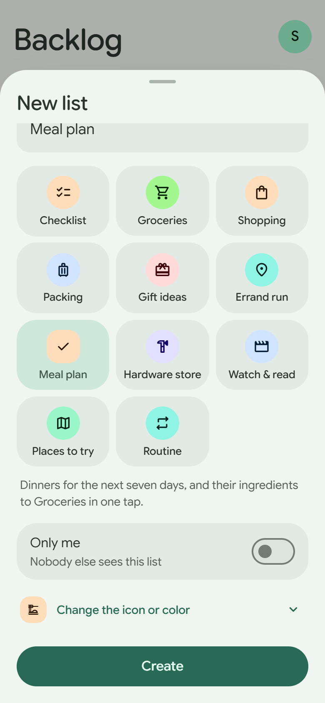
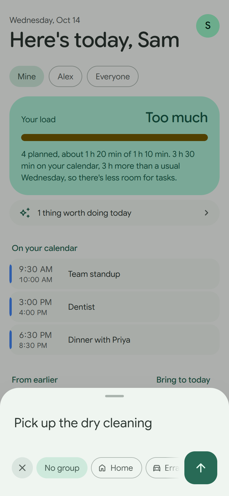
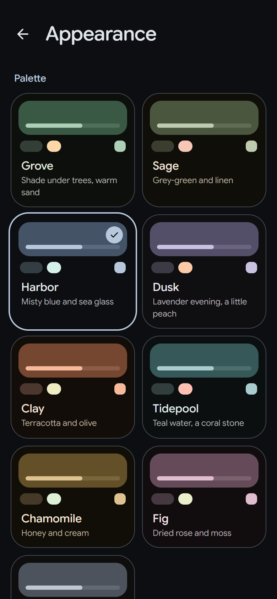

# Amble

A calm, shared planner for a household. It knows how full each day already is, from your tasks and your phone's calendar, and suggests what to do today and which day has room for something due later. It never nags.

Amble runs on your Android phone, with nothing to sign up for. Everything is on the phone, so it works offline from the start, and a household keeps in step through Google Drive. A household that wants more runs its own server, on a computer it keeps. That adds the web app for iPhones and computers, photos and files on tasks shared between devices, Claude and ChatGPT, and one AI model for everyone. Nobody runs a server for you.

Status: early but usable. The day list, backlog, task details, smart add, repeating tasks, lists from eleven templates, handing tasks to each other, the calendar, stats, the activity feed, settings, reminders, files on tasks and the connector for Claude and ChatGPT all work. Capacity is learned from what gets done, your phone's calendars shape how full each day is, and the planner suggests what to do today and where things fit. The Android app is headed for the Play Store. On an iPhone or a computer, Amble runs in the browser, served by your household's server; an iPhone app is open for anyone who wants to build it ([Help wanted](CONTRIBUTING.md#help-wanted)).

<p>
  
  
  
  
  
  
  
  
</p>

## Features so far

- Here's today: the first open each morning shows how full the day is, how much is on your calendar, what someone handed you, and a few backlog tasks worth pulling in, each with a reason. Nothing changes until you tap Add
- Today: your day list by time of day, a load meter, what carried over and what's due. Swipe right to finish a task, swipe left or long-press to move it, with Undo for both
- Your calendar: the Android app reads the calendars on your phone that you pick, through Android's own calendar permission. A day with more on it than usual has less room for tasks. Events stay on the phone: the household's copy only gets how many minutes of each day are busy. It only reads
- Planning help: a task due later shows the day with the most room before it, Plan my week lays out the next seven days around your calendar (tell it "keep Saturday free" and it does), and Tidy up suggests regrouping, merging duplicates and splitting tasks that are really several
- Backlog in collapsible groups with search, a quick-add sheet, and a task page for notes, steps, links, files, deadlines, time of day, must-do and estimates
- Reminders, only when you ask: pick a time on a task (or say "remind me Thursday at 6" in quick add) and your phone shows it at that time, even with Amble closed, with Done and Snooze on it. One set elsewhere, in a browser or by Claude, reaches the phone through the household's sync. In a browser, reminders show while Amble is open. Nothing else in Amble ever notifies you
- Files on tasks: photos, receipts, manuals and PDFs, up to 25 MB each, shared through your own server, or kept on the device that added them when the household syncs through Google Drive
- Moving a task shows the next two weeks with how full each day already is
- Smart add: type anything into quick add ("call mom tomorrow evening, out of milk and eggs, Alex should mow every Saturday") and an AI model turns it into tasks, list items and changes to existing tasks, using what's already in the household. You review and edit each one before anything is saved. Optional, and it works with any provider's key: Claude Haiku, GPT-6 Luna, Gemini Flash-Lite or GLM Flash (both with free tiers), anything on OpenRouter, or a model on your own machine through Ollama or LM Studio. Set it up in Settings, AI, with a monthly spending cap. A phone that syncs with your own server can use the server's model instead, with no key of its own
- Repeating tasks: on a schedule (every Sunday, the 1st, the 2nd Thursday, weekdays, seasonal months) or a set time after the last one was done, with skip and pause
- Capacity learned from what each person finishes, so how full a day looks needs no setup; anyone can pin their own numbers. Tasks without a size get one from the AI model in the background, and Stats shows how good its guesses are
- Lists from eleven templates: groceries that sort themselves by aisle as you type, shopping with links, prices and stores, packing lists from a kit that reset for the next trip, private gift ideas by person, errands by place, a meal plan whose ingredients go to Groceries in one tap, the hardware store, things to watch and read, places to try, and routines. Tap an item to check it off, hold it to change it, and change any list's sections. A grocery run plans as one task on the day with room, and shows what's left on the list
- A household: hand tasks to each other with a note, or share them with anyone
- Works offline: everything is on the device, so nothing waits for a connection. When copies meet again they merge field by field, and if two people changed the same thing, the later change wins
- Installable app (PWA) designed in Material 3 Expressive, with its spring motion tokens. It fits the screen it's on: a floating toolbar on phones, a navigation rail on a foldable or small tablet, and on wider screens a task or list opens beside the page you picked it from
- Material You theming: pick any color, or your Android phone's own, and Amble generates the full Material 3 palette (2025 spec) in five styles and three contrast levels, light, dark or automatic. It's saved per person and follows you across devices
- Three ways to start: on this device only; sync with Google, where a file in your Drive keeps your devices and your household in step; or your own server, at home or through Tailscale
- A connector (MCP) for Claude and ChatGPT with its own OAuth sign-in, on your own server: either can add, plan, complete and hand off tasks, keep shopping lists, check how full each day is, suggest what to do today, draft a week's plan and set reminders you ask for

## Run it locally

Needs Node 26+ (for its built-in `Temporal`) and pnpm.

```sh
pnpm install
cp .env.example .env    # dev sign-in is on by default, so no OIDC setup is needed
pnpm dev                # http://127.0.0.1:5174
```

The app runs on the device even in development: its API runs in a web worker in the browser, on SQLite compiled to WebAssembly and kept in the browser's own storage. `pnpm dev` also starts the server on port 8787 behind Vite, so you can try syncing with it: choose Use my own server, enter `127.0.0.1:5174`, and pick someone under dev sign-in. `http://localhost:5174` is another site to the browser, with its own storage: handy for a second "device".

[CONTRIBUTING.md](CONTRIBUTING.md) covers the layout, the checks to run and how the code is written. `pnpm test` runs the tests, including contrast checks for every theme. `node --env-file=.env scripts/eval-smart-add.ts` scores smart add against real household phrasing at each effort level, on the model the environment sets (a fraction of a cent per case).

For a realistic household to look at, write the demo database into an empty folder and run the built app on it, served by the server:

```sh
node scripts/demo.ts ../amble-demo sam@example.com
pnpm build
AMBLE_PUBLIC_URL=http://localhost:8787 AMBLE_DATA_DIR=../amble-demo node --env-file=.env server/index.ts
```

Open http://localhost:8787, choose Use my own server, and sign in as Sam. With that running (and Chrome installed), `node scripts/screens.ts` captures every screen at phone size in several themes (`AMBLE_VIEWPORT=820x1180` for a tablet), and `node scripts/smoke.ts sam@example.com` clicks through the core loop and fails on any broken step or console error. Each starts a fresh browser that joins the household through the server, as a new device would.

## The web app on its own

Most people use the Android app, or the web app their household's server serves. To host just the web app yourself, as static files with no server:

```sh
AMBLE_BASE=/ pnpm build    # static files in dist/web
```

Host `dist/web` anywhere that serves `index.html` for paths it doesn't have. `AMBLE_BASE` is the path it's served under, with slashes at both ends. First open asks what to call you and starts; nothing leaves the device. Settings, Sync and backup keeps a copy in your Google Drive and brings your other devices and your household in step, with no server in between. AI features work too, with a key that stays on the device. [docs/google-drive.md](docs/google-drive.md) covers the Google settings to build it with and the Google Cloud setup.

## The Android app

The same app in [Capacitor](https://capacitorjs.com): reminders show with the app closed, it reads the phone's calendars, and Drive sync keeps going without asking you to sign in again. It's headed for the Play Store. Until then, `node scripts/android.ts run` builds it and installs it on a plugged-in phone or an emulator; [docs/android.md](docs/android.md) has what it needs.

## Use it from Claude or ChatGPT

Amble's server includes a connector (MCP) that Claude and ChatGPT can both use. They can add, plan, complete and hand off tasks, keep shopping lists, and check how full each day is, acting as whoever connected them. Activity shows which assistant made each change.

Both connect to the same address, `<AMBLE_PUBLIC_URL>/mcp`. The server's own page (`<AMBLE_PUBLIC_URL>/server`) shows it, and so does Connect an assistant in Amble's Settings, on a device that syncs with the server.

**Claude (claude.ai, the desktop and phone apps, Claude Code).** In Claude, go to Settings, Connectors, Add custom connector, paste the address, then Connect and Allow.

**ChatGPT (on the web, in Developer mode).** In ChatGPT, turn on Developer mode under Settings, Apps, Advanced settings. Then choose Create in Apps, paste the address, pick OAuth, and Allow on the Amble page that opens. Developer mode is a beta: as of October 2026 ChatGPT can use every tool on Business, Enterprise and Edu plans, and only the read-only ones on Pro. ChatGPT identifies itself with its client metadata document (`https://chatgpt.com/oauth/client.json`) and comes back to `https://chatgpt.com/connector_platform_oauth_redirect`; dynamic registration works too, if it's picked in the app's OAuth settings. Nobody has connected a real ChatGPT account yet, so if you do, [say how it went](CONTRIBUTING.md#help-wanted).

Amble is its own OAuth 2.1 server: the assistant identifies itself, you sign in with your normal account on the server, and you can disconnect it in Settings, Your server (or on the server's page). It needs a public HTTPS URL the assistant can reach, and if Amble runs under a path prefix your proxy must also send `/.well-known/oauth-protected-resource<prefix>` and `/.well-known/oauth-authorization-server<prefix>` to it. Only apps on `AMBLE_OAUTH_CLIENT_HOSTS` (default `claude.ai,claude.com,chatgpt.com`) and local loopback apps can connect. If your `.env` sets that list from an older `.env.example`, add `chatgpt.com` to it.

**Local (same machine as the database).** ChatGPT only connects to remote servers, but Claude can also run Amble locally. `server/mcp-stdio.ts` talks to Claude over stdio and opens the server's database file directly, with no sign-in and nothing exposed to the network. It acts as the member named by `AMBLE_MEMBER`, who must have signed in once:

```sh
claude mcp add amble --scope user -e AMBLE_MEMBER=you@example.com -- node /path/to/amble/server/mcp-stdio.ts
```

For the Claude desktop app, add the same command under `mcpServers` in its config (Settings, Developer, Edit Config) and restart it. Set `AMBLE_DATA_DIR` if the database isn't in the repo's `data/` folder.

**The Amble skill.** `skill/amble/` teaches Claude how to use the connector the calm way: what goes in the backlog versus on a day, keeping days light, lists versus tasks, and short replies. Zip that folder and upload it in Claude under Customize, Skills, or copy it into a local skills folder with `node scripts/sync-skill.ts <skills-dir>`. To tell Claude about your own household (who's who, your time zone, what you'd rather not hear about), write it under a `## Household notes` heading in `skill/household.md`. Git ignores that file, and `sync-skill.ts` adds it to the end of the skill it copies.

## Self-host a server

A server is one more copy of the household, on a computer you keep. It serves the web app at its own address, keeps the household in step for devices that choose Use my own server, shares photos and files on tasks between them, hosts the connector for Claude and ChatGPT, and keeps the household's AI model, which everyone's devices use. A household that started in Google Drive can move onto it: the server joins the Drive file, and each device is offered a move to the server. Once a household has a server, the server is how it syncs. What the server has to set (the household's AI model, connected assistants, the code to add a phone) is in the app, under Settings, Your server, on any device that syncs with it; the server's own page at `<AMBLE_PUBLIC_URL>/server` has the same, for a browser.

Nobody runs one for you: each household that wants a server runs its own, and most never need one. [docs/self-hosting.md](docs/self-hosting.md) walks through it, written so an AI assistant can take you through it, and `deploy/setup.sh` does most of the work. It asks for the address, the emails and the sign-in client, then writes `.env` and `secrets/`, builds and starts the server, and checks each part. Run `deploy/setup.sh --check` any time to see what needs fixing, and `deploy/setup.sh --update` to update.

By hand, the same thing is:

```sh
cp .env.example .env    # set AMBLE_PUBLIC_URL, the emails, OIDC_CLIENT_ID, and AMBLE_DEV_LOGIN=0
mkdir -p data secrets
printf '%s' 'your-client-secret' > secrets/oidc_client_secret
printf '%s' 'your-ai-key' > secrets/ai_api_key   # optional: or set the model later in the app, Settings, AI
docker compose up -d --build
```

The server listens on `127.0.0.1:18085` (change with `AMBLE_PORT`); put your reverse proxy in front of it. It can run under a path prefix: set `AMBLE_PUBLIC_URL` to the full URL, for example `https://example.com/amble`, and the proxy may pass the prefix through or strip it. On the home network or through Tailscale, the Android app also reaches a server on plain `http`.

The server signs people in, and only people on its list: devices that sync with it, the connector, and its own page. For Google sign-in, create an OAuth client of type "Web application" with the redirect URI `<AMBLE_PUBLIC_URL>/auth/callback`, and set the consent screen's publishing status to "In production" so the server's Google Drive connection doesn't expire after 7 days. Any other OpenID Connect provider works too; [docs/sign-in.md](docs/sign-in.md) has the steps for Authelia, Authentik and Keycloak, and what to check when sign-in fails. Set `AMBLE_PRIVACY_CONTACT` to put a contact on the app's `/privacy` page, which Google's consent screen links to.

To add a phone, show the code in Settings, Your server on a device already in step with the server (or on the server's page) and scan it: in the Android app under Use my own server, Scan the code, or with the phone's camera to open the web app ready to join. To use the web app at the server's address, open `<AMBLE_PUBLIC_URL>` and choose Join through it; the address is already filled in. Google Drive sync in that browser needs the server's address in your Google Cloud setup ([docs/google-drive.md](docs/google-drive.md#google-cloud-setup)) and `AMBLE_GOOGLE_API_KEY` for the file picker. A web app hosted somewhere else can sync with the server too, once its address is in `AMBLE_APP_ORIGINS`.

Back up `data/`: it holds the database. `node server/backup.ts` inside the container writes a consistent copy of the database to `data/snapshots/almanac-latest.db` for file-level backups.

A household that syncs through Google Drive moves onto the server through the same file: an admin connects the server to Drive on its page, and each device then offers a move ([docs/google-drive.md](docs/google-drive.md#a-server-in-the-household)).

The server sends no notifications. A reminder set through Claude reaches the Android app through its background check of the household, about every 15 minutes.

## Contributing

Bug reports and pull requests are welcome. Start with [CONTRIBUTING.md](CONTRIBUTING.md).

## License

[AGPL-3.0](LICENSE)
